<h3><code>eduardo@github ~ $ ./contributions.sh</code></h3>

  

<h3><code>eduardo@github ~ $ whoami</code></h3>

<table>
  <tr>
    <td valign="top"></td>
    <td valign="top"></td>
  </tr>
</table>

 

<code>eduardo@github ~ $ cat stack.md</code>

 

| Category | Technologies |
|---|---|
| **Languages** | Java 11+, TypeScript, JavaScript, SQL, Python |
| **Backend** | Spring Boot, Spring Web, Spring Data JPA, Spring Security, Hibernate, Node.js |
| **APIs & Security** | REST, OpenAPI/Swagger, JWT, Authentication, Authorization, Service Integration |
| **Architecture** | Clean Architecture, Hexagonal, Layered, Microservices, Event-Driven, SOLID, Clean Code |
| **Messaging** | Kafka, RabbitMQ |
| **Databases** | PostgreSQL, MySQL, SQL Server, MongoDB, Redis, H2, Flyway |
| **Cloud & DevOps** | AWS, Azure, Docker, Kubernetes, GitHub Actions, CI/CD, Maven, Git |
| **Testing** | JUnit 5, Mockito, Testcontainers, Rest Assured, Unit & Integration Testing |
| **Tooling** | Postman, Insomnia, Jira, React |

